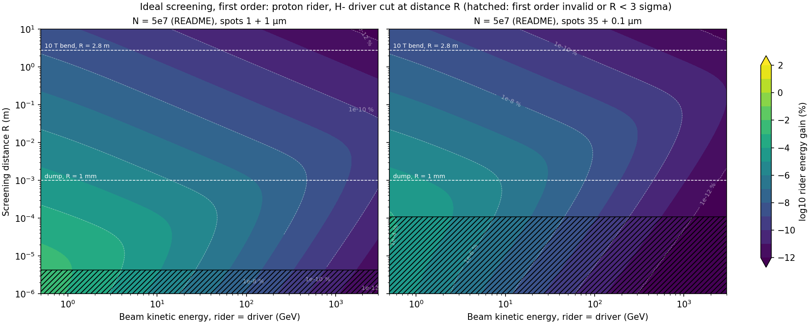
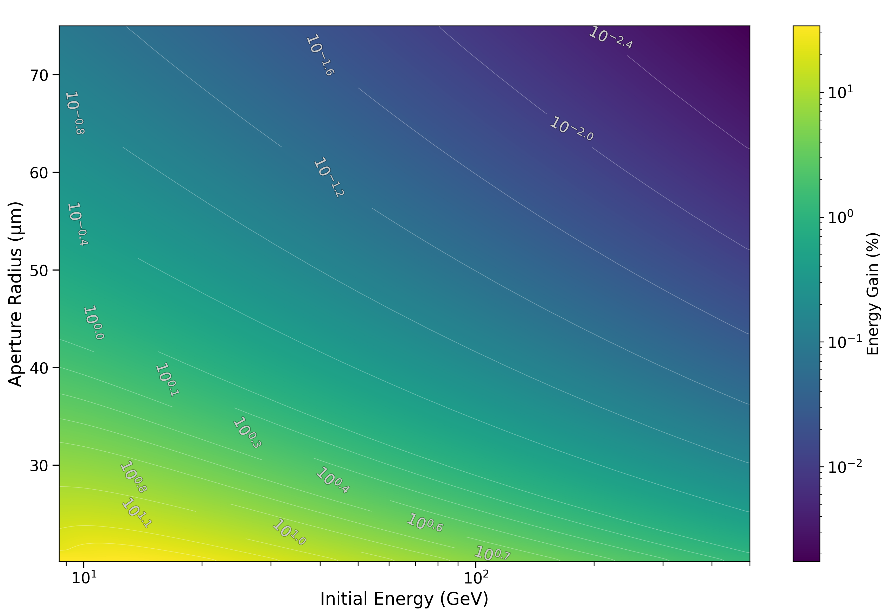
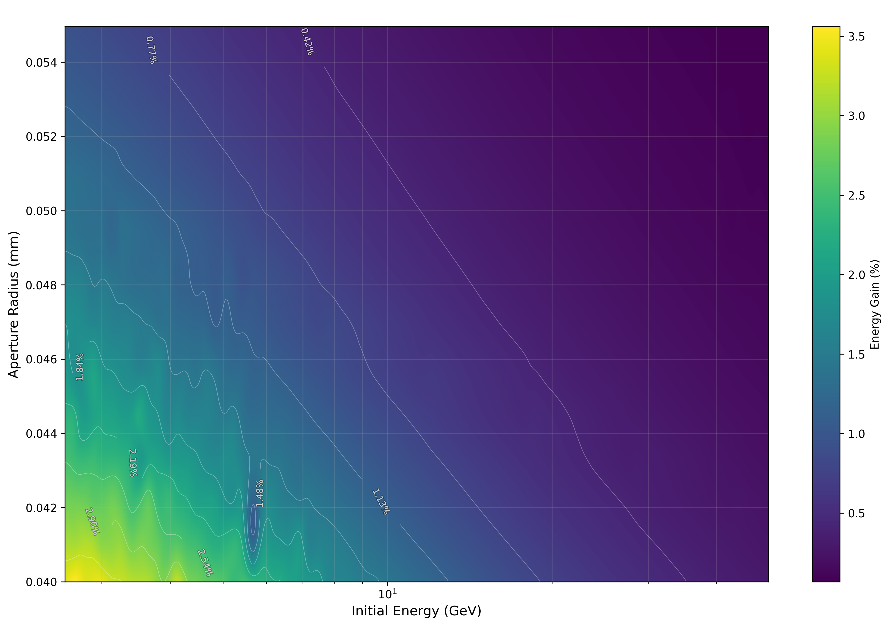

# LW Integrator

Version **0.11.0** adds exact visibility gates and charge driver trains,
NumPy/MLX/CuPy native PIC, and opt-in K-cloud corrections. Experimental boundary
APIs cover Drude response, conformal perfect conductors, and axial feedback.
Smooth external-field providers should use the exact second-order route for
energy-loss studies, with timestep checks. Stochastic emission remains off by
default and is guarded off on the general exact inertial-prehistory path.

See the [documentation overview](docs/source/overview.rst) and
[release notes](CHANGELOG.md) for supported routes, defaults, and limitations.
The [many-particle guide](docs/source/full_spin_particles.rst) covers the
physical-particle input, full-spin histories, and checkpoint workflow introduced
in v0.10.0. Numerical and physical convergence remain study-specific checks.

## Finite-spin pair solver — September 2026

The separate two-particle solver supports coupled magnetic self-reaction,
analytical derivatives, DOP853 integration, and resumable checkpoints. Compatible
fresh runs now select coordinated single-fit motion and magnetic-moment histories
automatically. The main GUI opens this workflow through **Full-spin particles…**.
These defaults do not change the older charge-only or bunch simulation paths.

The completed coarse–fine benchmark reduced late dipole-squared reaction-impulse
disagreement from 5.819e-2 to 1.034e-5 relative to the fine result. This establishes
recording-resolution consistency for that benchmark; independent conservation
and validity across other physical regimes remain separate checks.

See the [pair solver user guide](docs/source/finite_spin_pair.rst),
[history method](docs/single_fit_geometry.md), and
[drift-budget selection](docs/dipole_drift_budget.md). Internal integration may
adapt while history recording stays fixed. Arbitrary adaptive recording is not
supported by the new history method.

## Recent Updates (August 2026)

- **Explicit GUI/testbed CLI route** — `lw-simulate --testbed-config ...` loads and executes saved GUI/testbed configurations through `run_testbed()` without translating their schema, keeping configured 3D particles, beamline geometry, source smearing, self-consistency, and output settings authoritative.
- **Beamline geometry line-of-sight screening** — beam-pipe-like occluders can now block direct retarded field contributions between bunches when the source particle (at its retarded position) exits a pipe's transverse aperture. Residual fields arrive naturally via retarded time. Configured via `beamline_geometry` in JSON configs, `--beamline-geometry-enabled` / `--beamline-geometry-file` CLI flags, or the new "Beamline/Geometry" GUI tab. See `core/beamline_geometry.py` and `BeamlineGeometryConfig` in `core/types.py`.
- **General 3D particle initialization** — `create_particle_state_3d` supports arbitrary bunch orientation (`momentum_axis`), starting position, and longitudinal span. When `momentum_axis` is present in rider/driver config params, the 3D initializer is used automatically in both the testbed and CLI single-run paths. New work should prefer this full 3D surface; legacy z-axis configs remain supported for compatibility. The main GUI now also exposes a `Manual Particle Config` tab with rider/driver JSON editors for direct 3D setup.
- **Energy ledger per-direction and percent gains** — the energy ledger now records per-direction kinetic energy (x, y, z) and `final_percent_energy_gain` / `max_percent_energy_gain` for both rider and driver, in addition to the existing total and longitudinal-z metrics.
- **Experimental pseudo-grid reduced solver** — pseudo-grid mode now has an opt-in reduced solve path for `BUNCH_TO_BUNCH` studies. Per-step schedules select active rider/driver dynamic observers and a separate weighted field-representative set for cross-bunch retarded LW sources; non-field live particles deposit source charge directly onto field representatives while passive states are reconstructed from weighted active deltas. Adaptive-timestep runs are supported. Reduced same-bunch space charge is supported when each bunch keeps at least two active particles, using a hybrid source set that evaluates nearest live same-bunch neighbours exactly and uses field representatives for remaining farther charge. Field representatives in same-bunch space charge also carry a deposition-cloud RMS radius, which is combined with global space-charge softening so coarse finite clouds are not treated as singular point charges. When causal-history pruning is enabled, supported reduced B2B solves compact live histories and record retained-start/dropped-sample diagnostics. `scripts/pseudo_grid_feasibility_probe.py` provides a lightweight zero-charge/weak-charge sanity and `N > 100` timing probe; `scripts/pseudo_grid_feasibility_matrix.py` adds small matrix sweeps including crossing, adaptive crossing, stronger-charge, longer-window, and opt-in same-bunch space-charge cases; `scripts/pseudo_grid_microbenchmarks.py` times reduced-mode scheduling, slicing, active solve, space-charge matrix, and passive reconstruction phases; retarded same-bunch source histories are cached per source particle to reduce active-solve overhead. Maintained pseudo-grid unit and regression tests live in this `LW_integrator` repository; sibling feasibility-study workspaces should remain user-like screening/probe surfaces. The mode remains experimental, and too-small active sets still fall back to the canonical full solve.
- **Parallel blind sweeps** — the Sweep/Optimization GUI now exposes a worker-count control and reuses the maintained headless `SweepRunner` parallel path when `workers > 1`. Saved sweep configs can persist `workers`, and CLI sweeps still support `-j/--workers` overrides.
- **Radiation reaction surface** — radiation-reaction mode is now configurable from the main GUI Stability tab, the Sweep/Optimization tab, saved single-run configs, saved sweep configs, and the single-run CLI via `--radiation-reaction-mode`. The user-facing default is now `medina_lad`.
- **CLI/GUI parity** — the CLI sweep runner now calls the same core code paths
  as the GUI (`run_testbed()`, `SimulationOptions`), eliminating divergent
  behaviour between the two entry points.
- **Incomplete-sweep archiving** — sweeps with fewer than 100 completed runs
  are automatically relocated to `results/archive/incomplete/` on save
  (CLI, GUI, and library API).
- **Heatmap contour improvements** — reduced contour-line alpha, added
  edge-aware label clamping, and overlap culling so contour labels no longer
  clip at plot boundaries or stack on top of each other.
- **Driver energy sweep fix** — `driver_energy_gev` is now correctly converted
  to starting Pz in all sweep paths, fixing a bug where driver energy sweeps
  had no effect on BUNCH_TO_BUNCH simulations.

For the full history see [CHANGELOG.md](CHANGELOG.md).

---

The LW Integrator is a covariant charged-particle tracking code that evaluates
retarded Liénard–Wiechert potentials to obtain first-principles beam dynamics.
The repository contains a modernised `core` implementation that preserves the
validated reference physics, an updated Sphinx documentation set, and a collection
of validation scripts and notebooks. The methodology is documented in the
peer-reviewed article _Relativistic beam loading, recoil-reduction, and
residual-wake acceleration with a covariant retarded-potential integrator_
([Nucl. Instrum. Methods Phys. Res. A 1069 (2024) 169988](https://doi.org/10.1016/j.nima.2024.169988),
[arXiv:2310.03850](https://arxiv.org/abs/2310.03850)).

**Documentation:** [lw-integrator.readthedocs.io/en/latest](https://lw-integrator.readthedocs.io/en/latest)

---


---

## Contents

1. [Project overview](#project-overview)
2. [Repository layout](#repository-layout)
3. [Environment setup](#environment-setup)
4. [Running simulations](#running-simulations)

---

## Project overview

- **Physics focus.** The project began with a covariant retarded-potential
  solver. `core/trajectory_integrator.py` is now a compatibility facade;
  `core/equations.py` advances particles, and `core/integration_runner.py`
  manages runs. Exact source histories, native PIC, and boundary solvers have
  their own implementations and regression checks. Historical notebooks are
  reference material, not a universal numerical-parity baseline.
- **Self-consistency and the mass shell.** Force-updated mechanical spatial
  momentum determines on-shell gamma and beta in every radiation mode:
  $(E/c)^2=|\mathbf p|^2+(mc)^2$, with $\mathbf p=\mathbf P-q\mathbf A/c$.
  Two `fixed_geometry` force trials remain the default. The stopping check
  measures the mass shell, not successive-force convergence. `variable_geometry`
  recomputes trial geometry and is unsupported on the exact inertial endpoint
  route. A small mass-shell residual does not establish trajectory accuracy,
  timestep convergence, or a closed energy ledger. See
  [self-consistency](docs/source/self_consistency.rst).
- **Gamma reconciliation.** The integrator computes the Lorentz factor γ in two
  ways: from conjugate momentum (γ_energy) and from velocity (γ_velocity).
  Numerical differences between these can cause energy jumps. Five reconciliation
  methods are available via `GammaReconciliationMethod`:
  - **ADAPTIVE_WEIGHTED**: Velocity-dependent blending with configurable
    thresholds and weights. Trusts energy at low β, velocity at high β.
  - **FIXED_WEIGHTED**: Fixed 50/50 blend (or custom weight).
  - **USE_VELOCITY** / **USE_ENERGY**: Use one calculation exclusively.
  - **DISABLED** (default): No reconciliation. The other methods are
    diagnostic-only; they only reseed the next self-consistency iteration and
    have no effect with `medina_lad` radiation reaction or on the exact
    RFS/dipole path (a warning is emitted at run start).
    Configurable via API (`self_consistency_gamma_reconciliation_method` and related
    parameters) and GUI (Stability → Self-Consistency → Gamma Reconciliation).
- **Adaptive timestep and beta clamping.** The integrator includes numerical
  safety features for extreme relativistic regimes (γ > 10⁶):
  - **Beta clamping** on the legacy path uses
    `float64(1.0) - float64(1e-16)`, approximately `0.9999999999999999`.
    The proper-velocity-aware path uses a separate consistency check; this
    clamp is not a universal energy ceiling. See
    [high-gamma numerics](docs/source/high_gamma_numerics.rst) for the exact
    history representation and the limits of its validation.
  - **Adaptive timestep refinement** detects energy jumps during integration
    and automatically retries problematic steps with smaller timesteps. This
    is configurable via `AdaptiveTimestepConfig` and particularly useful for
    high-energy electron-wall simulations.
- **Trajectory stability analysis.** Post-integration validation assesses
  whether trajectories are numerically stable across multiple timesteps, even
  in regions with strong physical forces (radiation reaction, image charges).
  Rather than rejecting runs with large single-step jumps—which can represent
  valid physics—the analyzer checks for oscillatory instabilities, erratic
  evolution that cannot fit smooth polynomial trends, and multi-scale
  inconsistencies. This multi-step approach distinguishes numerical artifacts
  from physical behavior and is essential for unattended sweep and optimization
  runs. Configured via `SmoothnessConfig` with presets for strict,
  balanced, and permissive validation. See `core/smoothness_analyzer.py`
  for implementation details.
- **Macroparticle simulation.** Representative particles keep species charge
  $q_s$ as observer charge and species mass $m_s$ as inertia; population $N$
  weights source charge as $Nq_s$ and diagnostics as $N$. The legacy wall-image
  multiplier scales generated image charges, not the input observer charge.
  Its stochastic transverse displacement uses bunch position and momentum
  spreads before radial weighting. This is a spread prescription, not a
  demonstrated model of emittance evolution or an exact aperture boundary
  solution. See [image sources](docs/source/api/images.rst) and the separate
  [persistent exact clouds](docs/source/exact_macroparticle_sources.rst).
- **GUI and CLI entry points.** The GUI (`python -m lw_integrator.gui`) provides
  an interactive interface for single runs, parameter sweeps, and optimization,
  with real-time logging and an initial-state summary panel. For new particle
  setups, prefer the `Manual Particle Config` tab's rider/driver JSON editors so
  full 3D bunch fields such as `momentum_axis` and `starting_position_mm` are
  available directly. The `lw-simulate` console command (see [Command-line entry point](#command-line-entry-point)
  below) runs the same core code paths with JSON-configurable inputs. A minimal
  CLI demonstration lives in `examples/entrypoint_demo.py`.

---

## Repository layout

```
LW_integrator/
├── core/                 # Maintained integrator implementation and helpers
├── configs/              # JSON run and sweep configuration files
├── docs/                 # Sphinx configuration, sources, and build script
├── examples/
│   └── validation/       # Reference notebooks and validation examples
├── input_output/         # Particle bunch initialisation utilities
├── legacy/               # Archived notebooks (historical reference only)
├── lw_integrator/        # CLI, GUI, sweep runner, and testbed runner
├── optimization/         # Sweep/optimization engine, metrics, result I/O
├── results/              # Sweep and optimization output (git-ignored)
├── tests/                # Pytest suite covering physics and helper modules
├── .github/workflows/    # Continuous-integration pipelines (docs publishing)
├── core/_version.py      # Single source of truth for the project version
└── README.md             # You are here
```

---

## Environment setup

### System Dependencies

Before installing Python packages, ensure you have the required system dependencies:

**Ubuntu/Debian:**

```bash
sudo apt-get update
sudo apt-get install python3-tk python3-dev
```

**Fedora/RHEL:**

```bash
sudo dnf install python3-tkinter python3-devel
```

**macOS:**

```bash
# Tkinter is included with Python from python.org
# If using Homebrew Python:
brew install python-tk@3.11  # adjust version as needed
```

**Windows:**

```powershell
# Tkinter is included with standard Python installers from python.org
# No additional installation needed
```

> **Note:** The GUI components require Tkinter, which is **not** pip-installable and must be installed at the system level. If you see `ModuleNotFoundError: No module named 'tkinter'`, install the appropriate system package above.

### Python Environment

1. **Choose an existing compatible environment first.** In the synchronized
   workspace, check `~/work/environment-specs/maxiv-dev` and its `tango-dev`
   or `sardana-dev` profiles. Run from the checkout; do not install this project
   as editable into a shared environment. The docs workflow selects Python 3.11,
   and the documentation checks have also run on Python 3.12. The source uses
   annotation syntax incompatible with Python 3.8 and 3.9; package metadata
   alone does not establish support for those versions.

   If a project-specific environment is needed, keep it and package caches
   outside the synchronized work tree, for example:

   ```bash
   python3 -m venv "$HOME/.venvs/lw-integrator"
   source "$HOME/.venvs/lw-integrator/bin/activate"
   ```

2. **Install into a project-specific environment** with commonly used extras.
   Editable installation is suitable only for that isolated environment.

   **For general usage (simulation + GUI):**

   ```bash
   pip install -e .
   ```

   **For development (includes testing/linting tools and bump2version):**

   ```bash
   pip install -e ".[dev]"
   ```

   **For full installation (dev + examples + documentation):**

   ```bash
   pip install -e ".[dev,examples,docs]"
   ```

   - `dev` adds pytest, black, flake8, mypy, and bump2version for development
   - `examples` installs Jupyter and ipywidgets for interactive notebooks
   - `docs` brings in Sphinx, `sphinx-autobuild`, and related extensions

3. **(Optional) register the kernel for Jupyter usage.**

   ```bash
   python -m ipykernel install --user --name lw-integrator --display-name "LW Integrator"
   ```

### Troubleshooting

**Matplotlib backend issues:**

If you encounter matplotlib GUI errors, try setting a different backend:

```bash
export MPLBACKEND=TkAgg  # Linux/macOS
set MPLBACKEND=TkAgg     # Windows CMD
```

Or configure it in your script:

```python
import matplotlib
matplotlib.use('TkAgg')
import matplotlib.pyplot as plt
```

**Version management (developers only):**

The `bump2version` tool is included in the `dev` extras. If you only installed the base package (`pip install -e .`), you'll need to install dev dependencies to use versioning tools:

```bash
pip install -e ".[dev]"
```

---

## Running simulations

### GUI Application

The project includes a Tkinter-based GUI for single runs, parameter sweeps, and optimization:

```bash
python -m lw_integrator.gui
```

> **Note:** CLI testbed/sweep runs and the GUI share `run_testbed()` and
> `SimulationOptions`. Parity checks cover matching configurations, seeds, and
> supported routes. The native direct-integrator CLI and native PIC are separate
> paths; PIC has no GUI parity claim.

The GUI provides three operational modes:

**Single Run Mode** (Main tab):

- Configure and run individual simulations with real-time progress tracking
- Full control over particle properties, boundary conditions, and physics parameters
- A `Manual Particle Config` tab for direct rider/driver JSON entry, including full 3D bunch fields such as `momentum_axis`, `starting_position_mm`, and `longitudinal_span_mm`
- Direct radiation-reaction mode selection from the Stability tab (`medina_lad` default for new runs)
- Interactive trajectory visualization and energy/position analysis
- Export results in multiple formats (CSV, JSON, NPZ)
- Self-consistency iteration controls for high-gamma physics

**Sweep / Optimization Modes** (Sweep/Optimization tab):

#### Blind Sweep Mode

- **Parameter sweeps** over aperture radius, particle energy, transverse offset, and starting positions
- **Sweepable fixed parameters** - mass, charge, transverse momentum, timestep, wall position
- **Auto-timestep calculation** to maintain consistent integration resolution across energy ranges
- **Parallel execution** with configurable worker count for blind sweeps (start with a modest count such as `2-4`)
- **Radiation-reaction mode selection** persisted in saved sweep configs and mirrored into runtime execution
- **Trajectory saving** with configurable stride
- Results saved to timestamped directories with JSON summary and plots

#### Optimization Mode

- **Multiple algorithms**: Genetic Algorithm, Differential Evolution, Nelder-Mead, Multi-start
- **Convergence detection**: Early stopping when fitness plateaus (GA only, configurable tolerance and patience)
- **Objectives**: Maximize energy gain (%), minimize transverse deflection, or custom metrics
- **Real-time logging**: Progress tracking with generation/iteration updates
- **Top-N saving**: Automatically saves best configurations found

**Optimization Quick Start:**

1. Select "Optimization" mode
2. Choose optimizer (Genetic Algorithm recommended for global search)
3. Set convergence parameters:
   - Tolerance: 1e-6 (relative improvement threshold)
   - Patience: 10 generations (lookback window)
4. Define parameter ranges (at least 2 sweep dimensions required)
5. Run - optimizer automatically stops when converged or max iterations reached

**Performance Notes:**

Runtime depends on the workload, hardware, solver route, and convergence settings.
Early stopping may reduce evaluations, but an optimizer does not determine a
universal runtime or accurate timestep. Start with automatic step calculation
from relative closing speed, then check route-specific timestep convergence.
The LW runner uses proper time; native PIC uses lab time.

Results are saved to `results/sweeps/YYYYMMDD_HHMMSS_configname/` with convergence history, best parameters, and optional trajectory data.

### Command-line entry point

Installing the project (`pip install -e .` or via a wheel) exposes the
`lw-simulate` executable. The CLI uses sensible defaults (35 MeV electron
approaching a conducting aperture, `medina_lad` radiation reaction) but accepts
both inline parameter overrides and JSON configuration files.

**Basic usage with defaults:**

```bash
lw-simulate --quiet
```

**Override specific parameters:**

```bash
lw-simulate --steps 250 --time-step 5e-4 --aperture-radius 0.5 --output run.json
```

**Run a baseline without radiation-reaction recoil:**

```bash
lw-simulate --radiation-reaction-mode off --quiet
```

**Use a native direct-integrator configuration file:**

```bash
lw-simulate --config my_scenario.json --output results.json
```

**Run an existing GUI/testbed configuration unchanged:**

```bash
lw-simulate --testbed-config configs/run_configs/study_config.json \
  --output testbed_report.json
```

`--testbed-config` is for the full GUI/testbed JSON schema (`rider_params`,
`driver_params`, and `core_params`). It loads the configuration through the
testbed loader and runs `run_testbed()` directly, preserving configured 3D
particles, beamline geometry, driver trains, source smearing, cold-start and
self-consistency settings, and trajectory output. The JSON is authoritative:
ordinary direct-run arguments are not a general override layer. Supported
exceptions include stochastic-emission enable/disable, chi and recoil thresholds,
rate model, seed, instantaneous same-bunch clock, source-history representation,
checkpoint controls, and exact adaptive-pair controls. `--output` and `--quiet`
control reporting. Use `--config` only for the separate native direct-integrator schema.

**Run a parameter sweep from a sweep configuration:**

```bash
lw-simulate --sweep-config configs/sweep_configs/example_b2b_linked_energy_vs_driver_distance.json -j 4
```

The sweep runner writes results to `results/sweeps/YYYYMMDD_HHMMSS_configname/`
and detailed debug logs to `logcache/`. Sweeps with fewer than 100 completed
runs are automatically relocated to `results/archive/incomplete/`.

The JSON configuration file allows complete specification of simulation
parameters, particle bunches, and physics options. Example structure:

```json
{
  "steps": 1000,
  "time_step": 3e-7,
  "simulation_type": "conducting-wall",
  "aperture_radius": 0.01,
  "wall_position": 100.0,
  "rider": {
    "kinetic_energy_mev": 5.0,
    "mass_amu": 1.0,
    "charge_sign": 1.0,
    "position_z": 0.0
  }
}
```

Additional CLI options include:

- `--chrono-mode`: Retardation sampling strategy (`averaged` or `fast`)
- `--startup-mode`: Early-step handling (`cold-start`, `approximate-back-history`, or `inertial-prehistory`)
- `--radiation-reaction-mode`: Single-run radiation-reaction handling (`off`, `diagnostic_only`, `power_matched_damping`, `medina_lad`, or `medina_lad_validity`)
- `--image-weighting` / `--no-image-weighting`: Control image charge distribution
- Configure `self_consistency_enabled` in JSON; there is no `--self-consistency` flag
- `--sweep-config`: Path to a JSON sweep configuration (runs a full parameter sweep)
- `-j/--workers`: Parallel worker-process count for sweeps (start with a modest value)
- `--log-verbosity`: Override sweep log verbosity (`none`, `truncated`, or `full`)
- `--sc-verbosity`: Override self-consistency verbosity (0–3)
- `--adaptive-debug` / `--no-adaptive-debug`: Toggle adaptive timestep debug output

Run `lw-simulate --help` for complete option listing. See
[exact startup restrictions](docs/source/exact_path.rst) and
[Medina impulse guards](docs/source/radiation_reaction_plan.rst): `medina_lad`
caps the reaction impulse, while `medina_lad_validity` applies a validity guard
and retains the complete accepted impulse.

Conducting-wall runs apply radial weighting to image subcharges by default for
better agreement with the aperture geometry. Pass `--no-image-weighting` to
recover the historical uniform distribution when benchmarking or debugging.

Programmatic usage mirrors the console invocation: call
`lw_integrator.cli.main` with a list of CLI-style arguments. See
`examples/entrypoint_demo.py` for a ready-to-run demonstration that exercises
both patterns.

### Sweep heatmap generation

After a sweep completes you can generate publication-quality heatmaps with
the maintained packaged command `lw-generate-sweep-heatmap`:

```bash
lw-generate-sweep-heatmap results/sweeps/<sweep_dir> \
    --output gains.png --absolute-gains --log-param2 \
    --param1-min 1 --param1-max 140 --axis-param1-max 120 \
    --gain-min -50 --gain-max 50 --color-min -30 --color-max 40 \
    --num-contours 8 --no-markers --grey-zero --grey-centre 0 \
    --no-title
```

Use `--param1-max` / `--param2-max` to choose the data included in the
interpolation, and `--axis-param1-max` to crop the displayed x-axis after
interpolation. The explicit color limits keep positive and negative gain
regions visually comparable across related plots. Contour lines use reduced
alpha (0.18) and labels are automatically clamped to stay within the axes.
Overlapping labels are culled after the final layout pass so they never stack
on top of each other.

### Live sweep plotting

The maintained live sweep plotting commands are:

```bash
lw-plot-latest-live
lw-plot-from-logcache-live logcache/<sweep_log>.log
```

`lw-plot-latest-live` follows the most recent sweep log automatically.
`lw-plot-from-logcache-live` can run in static mode by default or in live mode
with `--live`.

### Saved trajectory plotting

Saved single-run trajectory files from the GUI/testbed can be plotted from the
CLI with `lw-plot-trajectory`:

```bash
lw-plot-trajectory results/testbed_runs/<run_dir>/trajectory_data_<timestamp>.json
lw-plot-trajectory results/testbed_runs/<run_dir>/trajectory_data_<timestamp>.npz
```

JSON trajectory files preserve rider/driver separation and the full core-state
history needed by the maintained plotting tools.
NPZ files use the standard compact `z/r/pz/pr/gamma` format shared with the
optimization tooling.

---

## Startup-mode default

`COLD_START` is the default startup mode for generated configs, CLI/GUI runs, and integration-style tests. Exact retarded endpoint runs require `INERTIAL_PREHISTORY`; see [the exact path](docs/source/exact_path.rst). Use `APPROXIMATE_BACK_HISTORY` only for explicitly labeled diagnostics or for reproducing older examples that require approximate retarded history initialization.

## Example configurations

Simple example configs live under `configs/`. Load them via the GUI
(**Configuration & Control → Load**) or pass them directly to the CLI.

### Single-run examples (`configs/run_configs/`)

| File                                                       | Description                                                                                                                                                                                                                           |
| ---------------------------------------------------------- | ------------------------------------------------------------------------------------------------------------------------------------------------------------------------------------------------------------------------------------- |
| `example_b2b_counter_propagating_proton_bunches.json`      | Two counter-propagating proton-mass bunches with opposite charge signs (proton/H- in the current config; 5+5 particles, 300 M stripped ions each), cold start. Demonstrates bunch-to-bunch energy exchange at non-relativistic energies. |
| `example_b2b_relativistic_proton_stationary_lead_ion.json` | Ultra-relativistic proton rider (Pz = 1,010,000 amu·mm/ns, γ ≈ 3369) approaching a stationary lead ion driver (1 T stripped ions, m = 207.2 amu). Uses `APPROXIMATE_BACK_HISTORY` startup as a diagnostic legacy history model. |

### Sweep examples (`configs/sweep_configs/`)

The ideal-screening maps below use a proton rider and a counter-propagating H-
driver with linked kinetic energies. The driver is removed behind an ideal
screen at distance $R$ from the rider, leaving the energy gained during its
approach. Each driver macroparticle supplies the source charge $N e$, while the
rider has observer charge $e$ and the proton mass.

The figure is a historical ideal prescribed-screen illustration. Its generating
calculation, exact-field comparison inputs, and result table are not distributed
with this revision, so its numerical gains and comparison tolerances are not
reproducible validation claims. A representative-observer gain is not a closed
population-weighted energy result: field energy, radiation, screen work, and
material losses must also be accounted for.



The existing sweep configs are retained as historical examples:
**`example_b2b_linked_energy_vs_driver_distance.json`** uses 1 µm rider and
driver spots, while
**`example_b2b_linked_energy_vs_driver_distance_35um_rider.json`** uses a
35 µm rider and 0.1 µm driver. Their old maps were artifacts of a cold start
and of assigning the observer charge $5\times10^7 e$ as well as the source
charge; they are not physical ideal-screening predictions.

---

**`example_conducting_wall_electron_aperture_sweep.json`** — 50×50 log-spaced sweep of initial energy (1–500 GeV) vs aperture radius (15–75 µm) for a single electron rider approaching a conducting wall. Rider transverse spot size 1 µm. Macroparticle mode enabled (charge multiplier ×1000, sigma multiplier ×2). (Historical note: results produced before the 2026-06-17 conducting-wall kinetic-energy `starting_Pz` migration commit used an outdated conducting-wall `starting_Pz` formalism.)



---

**`example_conducting_wall_electron_aperture_sweep_10um_spotsize.json`** — 100×100 log-spaced sweep of initial energy (1.8–90 GeV) vs aperture radius (40–550 µm) for a single electron rider with 10 µm transverse spot size approaching a conducting wall. Macroparticle mode enabled. (Historical note: results produced before the 2026-06-17 conducting-wall kinetic-energy `starting_Pz` migration commit used an outdated conducting-wall `starting_Pz` formalism.)


