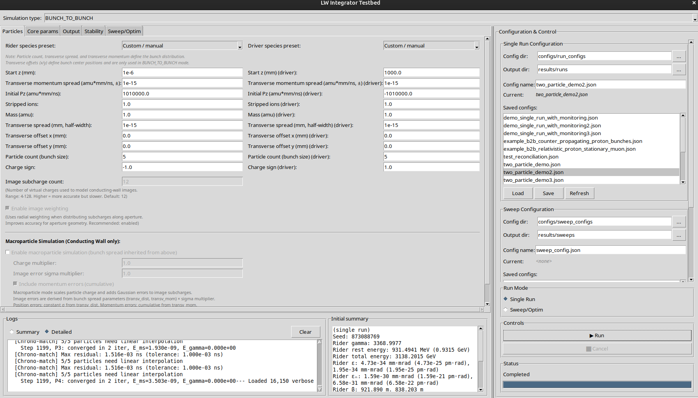

# LW Integrator (LWI)

The Liénard–Wiechert Integrator (LWI) tracks relativistic charged particles
with retarded Liénard–Wiechert fields. It evaluates retarded potentials in a
covariant formulation to obtain first-principles beam dynamics, and it is used
for studies of beam loading, recoil reduction, residual-wake acceleration and
bunch-to-bunch energy exchange. The method is described in
_Relativistic beam loading, recoil-reduction, and residual-wake acceleration
with a covariant retarded-potential integrator_
([Nucl. Instrum. Methods Phys. Res. A 1069 (2024) 169988](https://doi.org/10.1016/j.nima.2024.169988),
[arXiv:2310.03850](https://arxiv.org/abs/2310.03850)). The maintained code
includes substantial changes since that publication.

**Documentation:** [lw-integrator.readthedocs.io/en/latest](https://lw-integrator.readthedocs.io/en/latest)
(sources in [`docs/source`](docs/source)). **Release notes:** [CHANGELOG.md](CHANGELOG.md).



## Contents

1. [Capabilities](#capabilities)
2. [Installation](#installation)
3. [Quick start](#quick-start)
4. [Examples and configurations](#examples-and-configurations)
5. [Repository layout](#repository-layout)
6. [Documentation](#documentation)
7. [Citation and licence](#citation-and-licence)

## Capabilities

Each route has its own numerical and physical limits; the documentation states
them, and timestep and source-resolution convergence remain study-specific
checks.

- **Retarded fields.** Exact retarded sources from stored particle histories
  (visibility gates, driver trains, persistent finite macroparticle clouds,
  exact same-bunch charge fields) and a faster sampled retarded path. The
  sampled path is valid when its source history is complete, which a preflight
  guard checks. See [exact path](docs/source/exact_path.rst),
  [startup history](docs/source/startup_history.rst) and
  [exact macroparticle sources](docs/source/exact_macroparticle_sources.rst).
- **Startup modes.** `COLD_START` (valid only where fields are negligible
  while history builds up), `INERTIAL_PREHISTORY` (required by the exact
  endpoint route) and, for labelled diagnostics only, `APPROXIMATE_BACK_HISTORY`.
- **Radiation reaction.** `lw-simulate --radiation-reaction-mode` selects
  `off`, `diagnostic_only`, `power_matched_damping`, `medina_lad` (the default)
  or `medina_lad_validity`. The mode is also set from the GUI and saved
  configs. See [radiation reaction](docs/source/radiation_reaction_plan.rst).
- **Self-consistency and the mass shell.** Spatial mechanical momentum
  determines the on-shell γ and β. Two `fixed_geometry` force trials are the
  default; the check measures the mass shell, not force convergence or the
  energy ledger. Gamma reconciliation is disabled by default. See
  [self-consistency](docs/source/self_consistency.rst).
- **Bunch and macroparticle physics.** Representative particles carry species
  charge and mass; the population weights source charge and diagnostics.
  Conducting-wall image charges, source smearing, beamline-geometry
  line-of-sight screening, intra-bunch space charge, adaptive timesteps,
  energy ledgers and trajectory stability analysis, and an experimental
  pseudo-grid reduced solver for `BUNCH_TO_BUNCH` studies.
- **Magnetic moments and finite-spin particles.** Experimental intrinsic
  magnetic dipole moments, a pair solver with coupled magnetic self-reaction
  and resumable checkpoints, and a many-particle full-spin runner (GUI button
  **Full-spin particles…**). See [finite-spin pair](docs/source/finite_spin_pair.rst),
  [full-spin particles](docs/source/full_spin_particles.rst) and
  [checkpoints](docs/source/checkpoints.rst).
- **Native PIC core.** Particle-in-cell solver with NumPy, MLX and CuPy
  backends and an opt-in K-cloud correction. See [native PIC](docs/source/native_pic.rst).
- **Boundaries and external fields.** Experimental Drude, conformal
  perfect-conductor and axial-feedback boundaries ([boundary](docs/source/boundary.rst)),
  prescribed smooth external fields ([external fields](docs/source/external_fields.rst)).
- **Stochastic emission and photon transport.** Experimental and off by
  default; see [stochastic emission](docs/source/stochastic_quantum_emission.rst)
  and [photon transport](docs/source/photon_transport.rst).
- **GUI, CLI and sweeps.** A Tkinter GUI for single runs, blind parameter
  sweeps and optimisation (Genetic Algorithm, Differential Evolution,
  Nelder–Mead, multi-start); the `lw-simulate` command for single runs and
  sweeps from JSON; parallel sweep workers; and plotting tools for sweep
  heatmaps, live sweep logs and saved trajectories. The CLI sweep runner and
  the GUI share `run_testbed()` and `SimulationOptions`; native PIC is a
  separate path with no GUI parity claim.

## Installation

The GUI needs Tkinter, which is not pip-installable. Install it at system
level if `import tkinter` fails:

```bash
sudo apt-get install python3-tk python3-dev      # Debian/Ubuntu
sudo dnf install python3-tkinter python3-devel   # Fedora/RHEL
brew install python-tk@3.11                      # macOS with Homebrew Python
```

The Python.org installers for macOS and Windows include Tkinter.

Python 3.10 or later is required (the documentation checks run on 3.11).
Create a project-specific environment and install from a checkout:

```bash
git clone https://github.com/benfolsom/LW_integrator
cd LW_integrator
python3 -m venv .venv && source .venv/bin/activate
pip install -e .                    # simulation and GUI
pip install -e ".[dev]"             # plus pytest, black, flake8, mypy, bump2version
pip install -e ".[dev,examples,docs]"   # plus Jupyter notebooks and Sphinx
```

If matplotlib reports GUI backend errors, set `MPLBACKEND=TkAgg`.

## Quick start

Launch the GUI:

```bash
python -m lw_integrator.gui
```

Run the command-line entry point with its defaults (a 35 MeV electron
approaching a conducting aperture, `medina_lad` radiation reaction):

```bash
lw-simulate --quiet
lw-simulate --steps 250 --time-step 5e-4 --aperture-radius 0.5 --output run.json
lw-simulate --radiation-reaction-mode off --quiet     # baseline without recoil
```

Run a saved GUI/testbed configuration unchanged. `--testbed-config` takes the
full GUI schema (`rider_params`, `driver_params`, `core_params`); the JSON is
authoritative and ordinary direct-run arguments are not a general override
layer:

```bash
lw-simulate --testbed-config configs/run_configs/example_b2b_counter_propagating_proton_bunches.json \
  --output testbed_report.json
```

Run a parameter sweep. Results go to `results/sweeps/YYYYMMDD_HHMMSS_configname/`
and debug logs to `logcache/`; sweeps with fewer than 100 completed runs are
moved to `results/archive/incomplete/`:

```bash
lw-simulate --sweep-config configs/sweep_configs/example_b2b_linked_energy_vs_driver_distance.json -j 4
```

`--config PATH` loads the separate native direct-integrator schema. Run
`lw-simulate --help` for all options. The same entry point is available from
Python as `lw_integrator.cli.main(argv)`; `examples/entrypoint_demo.py` shows
both patterns.

Post-processing commands installed with the package:

```bash
lw-generate-sweep-heatmap results/sweeps/<sweep_dir> --output gains.png
lw-plot-latest-live                                   # follow the latest sweep log
lw-plot-from-logcache-live logcache/<sweep_log>.log [--live]
lw-plot-trajectory results/testbed_runs/<run_dir>/trajectory_data_<timestamp>.json
lw-monitor-optimization                               # optimisation progress
lw-tabulate-best-runs                                 # best runs of an optimisation
```

Run the tests with `pytest` (markers such as `-m unit` and `-m physics` narrow
the selection).

## Examples and configurations

Example JSON files live under `configs/`; load them from the GUI
(**Configuration & Control → Load**) or pass them to the CLI.

| Directory | Contents |
| --- | --- |
| `configs/run_configs/` | Single runs, e.g. `example_b2b_counter_propagating_proton_bunches.json` (proton/H⁻ bunches at non-relativistic energy), `example_b2b_relativistic_proton_stationary_lead_ion.json` (diagnostic legacy-history example), `example_native_pic.json`, `full_spin_three_particles.json`, and the `two_particle_demo*.json` set |
| `configs/sweep_configs/` | Parameter sweeps, e.g. `example_b2b_linked_energy_vs_driver_distance.json` (proton rider and H⁻ driver with linked kinetic energies) and `example_conducting_wall_electron_aperture_sweep.json` |

Some saved configs and figures are historical illustrations from earlier
revisions and are not validation claims; the documentation states what each
workflow does and does not establish. Scripts and notebooks under
`examples/` and `examples/validation/` are reference material, not a universal
numerical-parity baseline.

## Repository layout

```
LW_integrator/
├── core/                 # Integrator, retarded fields, native PIC, boundaries
├── lw_integrator/        # CLI, GUI, sweep runner, testbed runner, plotting tools
├── optimization/         # Sweep/optimization engine, metrics, result I/O
├── input_output/         # Particle bunch initialisation utilities
├── configs/              # JSON run and sweep configurations
├── docs/                 # Sphinx configuration and sources, build script
├── examples/             # Example scripts and validation notebooks
├── legacy/               # Archived notebooks (historical reference only)
├── tests/                # Pytest suite (physics, unit and integration tests)
├── results/              # Sweep and optimisation output (git-ignored)
└── core/_version.py      # Single source of the project version
```

## Documentation

- [Overview](docs/source/overview.rst) and [quick start](docs/source/quickstart.rst)
  of the documentation guide.
- [Recent changes](docs/source/recent_changes.rst) and [CHANGELOG.md](CHANGELOG.md)
  for dated updates, fixes and the results they affect.
- [Validation](docs/source/validation.rst) and
  [evidence status](docs/source/evidence_status.rst) for what is and is not
  established.
- Build the documentation locally with `bash docs/build_docs.sh` (add `-w` for
  live rebuilds).

## Citation and licence

If you use LWI in published work, please cite the article above
(DOI [10.1016/j.nima.2024.169988](https://doi.org/10.1016/j.nima.2024.169988)).
LWI is released under the GPL-3.0 licence; see [LICENSE](LICENSE).
